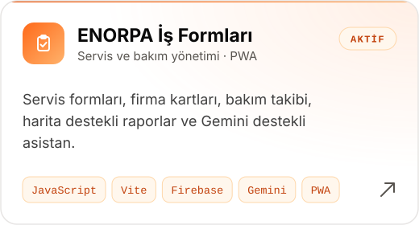
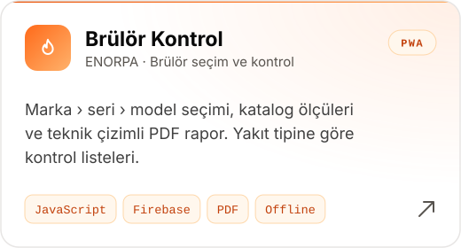
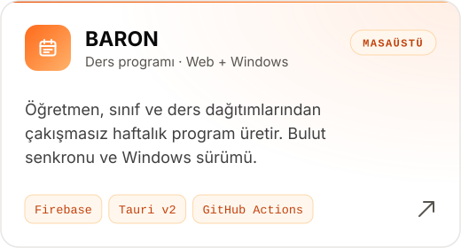

<!-- Görselleri güncellemek için: python scripts/generate_assets.py -->

<picture>
  <source media="(prefers-color-scheme: dark)" srcset="assets/banner-dark.svg">
  
</picture>

  
  
  
  

## Hakkımda

Mekatronik mühendisiyim; [**ENORPA**](https://enorpa.com/tr/)'da endüstriyel otomasyon ve enerji sistemleri üzerine çalışıyorum. Sahada karşılaştığımız gerçek iş problemlerini — servis formları, brülör kontrolleri, saha raporları, bakım takibi — yapay zeka destekli geliştirmeyle ekiplerin telefonundan kullanabileceği web uygulamalarına dönüştürüyorum.

- 🏭 **Alan** — endüstriyel otomasyon, yakma ve enerji sistemleri
- 📱 **Ürettiklerim** — çevrimdışı çalışan PWA'lar, Firebase tabanlı iş uygulamaları, masaüstü araçlar
- 🤖 **Yaklaşım** — AI destekli geliştirme ile fikirden canlı ürüne hızlı iterasyon
- 🌱 **Şu an** — [effeyc](https://effeyc.pages.dev): günlük hayatı kolaylaştıran uygulamalarımın vitrini

## Öne çıkan projeler

  <a href="https://github.com/ferhathaciosmanoglu/isform"><picture><source media="(prefers-color-scheme: dark)" srcset="assets/card-isform-dark.svg"></picture></a>
  <a href="https://github.com/ferhathaciosmanoglu/enorpa-field-report-pwa"><picture><source media="(prefers-color-scheme: dark)" srcset="assets/card-saha-raporu-dark.svg"></picture></a>

  <a href="https://github.com/ferhathaciosmanoglu/EnorpaS"><picture><source media="(prefers-color-scheme: dark)" srcset="assets/card-brulor-dark.svg"></picture></a>
  <a href="https://github.com/ferhathaciosmanoglu/FERCONVERT_PR"><picture><source media="(prefers-color-scheme: dark)" srcset="assets/card-ferconvert-dark.svg"></picture></a>

  <a href="https://github.com/ferhathaciosmanoglu/BARON_DERS_PROGRAMI_OLUSTURUCU"><picture><source media="(prefers-color-scheme: dark)" srcset="assets/card-baron-dark.svg"></picture></a>
  <a href="https://github.com/ferhathaciosmanoglu/effeyc"><picture><source media="(prefers-color-scheme: dark)" srcset="assets/card-effeyc-dark.svg"></picture></a>

  <b>Canlı dene →</b>
  <a href="https://ferhathaciosmanoglu.github.io/enorpa-field-report-pwa/">Saha Raporu</a> ·
  <a href="https://ferhathaciosmanoglu.github.io/FERCONVERT_PR/">FERCONVERT</a> ·
  <a href="https://effeyc.pages.dev">effeyc</a> ·
  <a href="https://ferhathaciosmanoglu.github.io/KARTVIZIT_PRIME/">Dijital Kartvizit</a>

<b>Diğer projeler</b>

| Proje | Ne yapar? |
| --- | --- |
| [**FERNESS**](https://github.com/ferhathaciosmanoglu/FERNESS) | Bulut tabanlı fitness programı — program oluşturma, antrenman takibi, ölçüm ve kalori |
| [**Zihin Alanı**](https://github.com/ferhathaciosmanoglu/asm) | Kategori ve önceliğe göre görev planlayıcı, hatırlatıcılar ve koyu tema |
| [**Dijital Kartvizit**](https://github.com/ferhathaciosmanoglu/KARTVIZIT_PRIME) | vCard, QR ve NFC ile paylaşılan, çevrimdışı çalışan kartvizit |

Bunlara ek olarak şirket içinde kullanılan bazı uygulamalar özel depolarda tutuluyor.

## Çalışma prensiplerim

| 📶 Çevrimdışı öncelikli | 🔒 Gizlilik odaklı | 🧰 Sahadan gelen ihtiyaç |
| --- | --- | --- |
| Sahada internet olmasa da çalışan PWA'lar, otomatik kaydedilen taslaklar | Mümkün olan her işlem cihazda yapılır; dosyalar gereksiz yere sunucuya gitmez | Her uygulama gerçek bir iş akışından doğar ve kullanıcıyla birlikte gelişir |

## Teknolojiler

| Alan | Araçlar |
| --- | --- |
| **Arayüz** |       |
| **Bulut ve altyapı** |      |
| **Masaüstü ve mobil** |   |
| **Mühendislik** |       |
| **AI ile geliştirme** |   |

 

  Aklında bir iş akışı mı var? <a href="mailto:frht.hosm@gmail.com">Yaz</a>, birlikte uygulamaya dönüştürelim.

